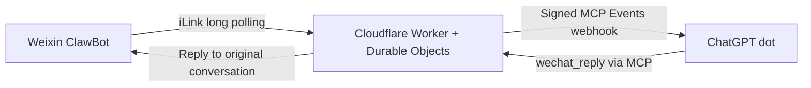

# Weixin Agent Bridge

[English](README.md) | [简体中文](README.zh-CN.md)

**Chat with your ChatGPT dot from Weixin (WeChat) ClawBot, using a self-hosted Cloudflare bridge.**

Weixin Agent Bridge connects messages from your own Weixin ClawBot account to a ChatGPT dot. It runs on Cloudflare Workers and SQLite-backed Durable Objects: no VPS, local daemon, or full OpenClaw installation is required for the bridge. Incoming messages are delivered through MCP Events, and the dot can reply to the original Weixin conversation through an authenticated MCP tool.

The bridge does not call a model API or require an OpenAI API key. Model execution happens in your compatible ChatGPT client, whose availability and permissions are controlled by OpenAI. This is an experimental, single-owner project—not a multi-tenant hosted service or an officially endorsed integration.

## Deploy with an agent skill

Install the included [`deploy-weixin-bridge` skill](skills/deploy-weixin-bridge/SKILL.md), then ask your agent to deploy your own copy. The skill automates preparation and guides deployment, OAuth, QR binding, and verification; login and consent remain yours. [Installation and invocation guide](docs/SKILL.md).

## Deploy your own copy

[](https://deploy.workers.cloudflare.com/?url=https://github.com/devinqiu888/weixin-agent-bridge)

Click the button to start Cloudflare’s guided repository-copy and deployment flow in **your own GitHub and Cloudflare accounts**. Your deployment gets separate storage and credentials; the author’s binding and conversations are not copied.

After deployment, configure your public `APP_ORIGIN`, a unique management secret, and trusted callback settings, then complete ChatGPT OAuth and scan with your own Weixin account. This is a guided deployment entry point, not zero-configuration account authorization. See the [one-click deployment guide](docs/DEPLOY.md).

## How it works



The Worker handles Weixin polling, durable message storage, OAuth, webhook delivery, and replies. The model does not need to repeatedly poll for new messages.

## Features

- QR-code binding for one Weixin owner per deployment.
- Text messages from the bound owner only; replies target an existing message, not an arbitrary recipient.
- OAuth with PKCE and dynamic client registration for ChatGPT connections.
- MCP tools: `wechat_status`, `wechat_receive`, `wechat_reply`, and `wechat_disconnect`.
- `message.created` subscriptions with signed callback verification and a persistent delivery queue.
- Message deduplication and durable send reservations; uncertain sends are not retried automatically.
- Administrator diagnostics that report counts without recording message content in diagnostic fields.

## Validation status

On October 30, 2026, a live single-account test completed **four automatically triggered text conversations**. The dot reported four successful `wechat_reply` calls, the bridge recorded four sent replies, and the user confirmed receiving replies in Weixin.

Observed time from event creation to successful send was approximately **34–95 seconds** in that small test. These are execution-record estimates, not a benchmark, delivery guarantee, or promise of instant replies. Images, voice, files, multi-user operation, and long-term reliability have not been validated.

## Get started

Requires Node.js 22.13+, npm, a Cloudflare account with Workers and SQLite Durable Objects available, a compatible Weixin ClawBot account, and a ChatGPT client/account that supports custom OAuth MCP connections and MCP Events.

```sh
git clone https://github.com/devinqiu888/weixin-agent-bridge.git
cd weixin-agent-bridge
npm ci
npm run check
npm run build
```

`npm run build` is a dry run; it does not deploy. Follow the [deployment guide](docs/INSTALL.md) to configure your Worker origin, secrets, OAuth redirects, and trusted event callback hosts. Then install the MCP connection in ChatGPT, bind Weixin by scanning a QR code, and ask your dot to subscribe to `message.created` and reply to the original conversation.

For local development, copy `.dev.vars.example` to `.dev.vars`, supply your own random management token, and run `npm run dev`. Never commit `.dev.vars`.

## Scope and limitations

- **Single owner:** one Weixin binding and one active OAuth connection/event subscription per deployment. A new authorization replaces the previous grant.
- **Controlled callback destinations:** event delivery is disabled until trusted exact callback hosts are configured. The allowlist is not a complete implementation of DNS-rebinding-resistant IP pinning. Do not expose this as an arbitrary-client webhook relay.
- **Data retention:** old pending messages are cleaned up during polling. Sent and uncertain records remain for deduplication until disconnect. Review the [security and data notes](docs/SECURITY.md) before using real conversations.
- **Client-dependent:** connecting an MCP server alone does not make every ChatGPT client accept background events. Platform access, task execution, and approval rules still apply.
- **Costs:** no model API billing is initiated by this bridge, but Cloudflare usage and your ChatGPT access may incur costs. Continuous long polling keeps a Durable Object active; do not assume it fits a free allowance.
- **Experimental release:** the source is open, but the plugin has not been submitted to or approved for an official directory.

## Documentation

- [中文介绍](README.zh-CN.md)
- [Deployment and OAuth setup](docs/INSTALL.md)
- [Architecture and roadmap draft](docs/PROJECT.md)
- [Security and data handling](docs/SECURITY.md)
- [Validation record](docs/VALIDATION.md)

## License

[MIT](LICENSE). Tencent-derived protocol code is credited in [THIRD_PARTY_NOTICES.md](THIRD_PARTY_NOTICES.md). This independent project is not affiliated with or endorsed by Tencent, OpenAI, or the OpenClaw project.
