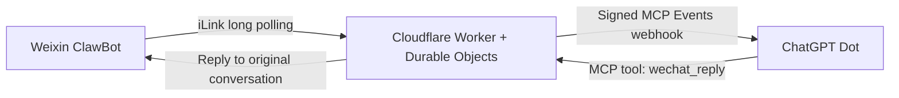

# Weixin Agent Bridge

[English](README.md) | [简体中文](README.zh-CN.md)

## 1. Purpose

This project aims to use the existing ClawBot interface in the Weixin (WeChat) client, bridge it through Cloudflare, and connect to ChatGPT Pro's Dot service through MCP, enabling conversations with dot and file transfers directly within Weixin.

It is designed for personal self-hosting: each user deploys the bridge in their own Cloudflare account and connects their own Weixin and ChatGPT accounts. **Basic text conversations and image transfer are working. Image transfer has been confirmed through user testing; support for other file types still needs further development.** Availability of Dot, plugins, and event capabilities depends on the features enabled for the user's account.

## 2. Project progress

**The initial implementation is working, and the project is still being refined as a prototype.**

Implemented:

- Weixin QR-code binding and a ChatGPT OAuth connection.
- Weixin text messages bridged through Cloudflare, automatically triggering dot through MCP Events.
- Replies sent back to the original Weixin conversation through MCP tools.
- Image transfer, confirmed through user testing.
- Single-owner message deduplication, send-state tracking, and skill-assisted deployment.

A live test on October 30, 2026 completed four automatically triggered text messages and successful replies, with the user confirming receipt in Weixin. Estimated event-to-send times were 34–95 seconds in that test; these execution-record estimates do not guarantee instant replies. See the [validation record](docs/VALIDATION.md).

Next priorities:

- **Improve encryption and privacy management on the Worker side to prevent data exposure.** This includes application-level encryption of stored messages and files, key management and rotation, access controls, log redaction, and data retention and deletion.
- **Improve image transfer and extend support to other file types.** Build on the user-tested image capability by validating formats, sizes, and reliability, improving access controls and cleanup, and adding other file types.
- **Improve reliability and deployment usability.** Validate long-running subscription renewal, failure recovery, latency, and independent onboarding by other users.

OAuth, management secrets, and callback signatures are already present. These protections do not mean application-level message encryption, end-to-end encryption, or a production security audit has been completed. The current version supports single-owner self-hosting only. Read the [security and data notes](docs/SECURITY.md) before use.

## 3. How it currently works



1. The user sends a text message in their Weixin ClawBot conversation.
2. Cloudflare receives it through iLink long polling. Durable Objects store the binding, message state, and event queue.
3. The bridge emits a `message.created` event to trigger the connected dot, without requiring the model to poll repeatedly.
4. The dot calls `wechat_reply`, and the bridge uses the original message identifier to send the reply to the same Weixin conversation.

The bridge infrastructure runs entirely on Cloudflare, with no VPS, local daemon, or full OpenClaw installation required. ChatGPT performs model inference; the bridge does not call a model API or require an OpenAI API key. Cloudflare resources and ChatGPT usage may still incur costs.

The diagram shows the text-message flow. Image transfer has been confirmed through user testing; its specific path and supported scope will be documented further.

## 4. Skill installation and one-click deployment

“One-click deployment” means having an agent perform the preparation, configuration, deployment, and checks it can execute. Cloudflare/GitHub sign-in, ChatGPT authorization, and Weixin QR scanning still require the user.

### Step 1: Prepare your accounts and tools

Use your own Cloudflare, GitHub, and Weixin ClawBot accounts, plus a ChatGPT Pro account with Dot and the required MCP capabilities enabled. Use a Codex environment that supports skills; compatibility with other agents has not been individually validated.

### Step 2: Install the skill

Send this instruction to Codex:

```text
Use $skill-installer to install this deployment skill:
https://github.com/devinqiu888/weixin-agent-bridge/tree/main/skills/deploy-weixin-bridge
```

Restart Codex after installation so it discovers the skill. A command-line installation option is available in the [skill installation guide](docs/SKILL.md).

### Step 3: Start deployment

```text
Use $deploy-weixin-bridge to deploy my own Weixin ClawBot-to-ChatGPT Dot bridge on Cloudflare,
complete the ChatGPT connection and Weixin binding, and verify a text round trip.
Complete the configuration, deployment, and checks you can perform; tell me when I need to sign in, authorize, or scan.
Check any existing same-name service before making changes.
```

The skill helps identify the target account, prepare a separate management secret, deploy the Worker and Durable Objects, and verify the connection in stages. Each user gets their own deployment and credentials; the author's Weixin binding and conversations are not copied.

### Step 4: Authorize, scan, and verify

Follow the agent's prompts to complete ChatGPT OAuth and scan with your own Weixin account. Once the event subscription is established, send a test message and confirm that a reply arrives in the original conversation.

The skill format and six configuration-helper tests have passed. The newly packaged skill has not yet completed an independent onboarding test in another user's account.

For the Cloudflare web-based deployment flow, use:

[](https://deploy.workers.cloudflare.com/?url=https://github.com/devinqiu888/weixin-agent-bridge)

Further instructions: [Skill installation and usage](docs/SKILL.md) · [Deploy to Cloudflare](docs/DEPLOY.md) · [Manual deployment and OAuth setup](docs/INSTALL.md).

## 5. Open-source license

This project uses the [MIT License](LICENSE), permitting use, modification, and distribution subject to its terms.

Tencent-derived protocol code is credited in [THIRD_PARTY_NOTICES.md](THIRD_PARTY_NOTICES.md). This is an independent open-source project, not affiliated with or endorsed by Tencent, OpenAI, or the OpenClaw project. It has not been approved for an official plugin directory.
