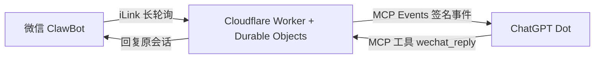

# Weixin Agent Bridge

[English](README.md) | [简体中文](README.zh-CN.md)

## 一、项目目的

本项目目的在于利用微信客户端已有 Clawbot 接口，通过 Cloudflare 桥接、MCP 接入 ChatGPT Pro 的 Dot 服务，实现在微信客户端内与 dot 对话及传输文件功能。

项目面向个人自托管使用：桥接服务部署在使用者自己的 Cloudflare 账号，绑定本人的微信与 ChatGPT。**目前已初步实现文字对话，文件传输属于后续目标。** Dot、插件及事件能力是否可用，仍以使用者账号实际开放情况为准。

## 二、项目进度

**项目已初步实现，处于原型完善阶段。**

已完成：

- 微信扫码绑定与 ChatGPT OAuth 连接。
- 微信文字消息通过 Cloudflare 桥接，由 MCP Events 自动触发 dot 处理。
- dot 通过 MCP 工具将回复发送回原微信会话。
- 单账号消息去重、发送状态记录，以及 Skill 辅助部署。

2026 年 10 月 30 日完成首轮真实测试：4 条文字消息自动触发处理并成功回发，用户确认微信端收到回复。本轮事件到发送完成约为 34–95 秒，仅为运行记录估算，不保证秒回。详见 [验证记录](docs/VALIDATION.md)。

后续重点：

- **完善 Worker 端的加密与隐私管理，防止隐私泄漏。** 重点包括消息及文件的应用层加密存储、密钥管理与轮换、访问权限、日志脱敏，以及数据保留和删除机制。
- **实现文件传输。** 补充文件接收、传递、访问控制与清理流程；目前尚未实现完整文件传输链路。
- **改善稳定性与部署体验。** 验证长期订阅续期、异常恢复和延迟表现，完善其他用户独立部署的完整流程。

现有版本已具备 OAuth、管理密钥和回调签名等保护，但不代表已完成应用层消息加密、端到端加密或生产安全审计。目前仅支持单账号自托管。使用前请阅读 [数据与安全说明](docs/SECURITY.md)。

## 三、当前工作方式



1. 用户在微信 ClawBot 会话中发送文字。
2. Cloudflare 通过 iLink 长轮询接收消息，使用 Durable Objects 保存绑定、消息状态及事件队列。
3. 桥接服务发送 `message.created` 事件，触发已连接的 dot 处理消息，无需模型循环轮询。
4. dot 调用 `wechat_reply`，桥接服务按原消息标识将回复送回同一微信会话。

桥接基础设施全部运行在 Cloudflare，无需 VPS、本地常驻程序或完整 OpenClaw 环境。模型推理由 ChatGPT 承担，桥接服务本身不调用模型 API，也不需要 OpenAI API Key。Cloudflare 资源及 ChatGPT 使用仍可能产生费用。

上图描述的是当前已验证的文字链路；文件传输完成后将补充对应流程。

## 四、Skill 一键安装部署教程

“一键部署”指让 agent 自动完成可执行的准备、配置、部署和检查。Cloudflare / GitHub 登录、ChatGPT 授权及微信扫码仍需本人完成。

### 1. 准备账号与工具

准备自己的 Cloudflare、GitHub、微信 ClawBot，以及已开放 Dot 和所需 MCP 能力的 ChatGPT Pro 账号。使用支持 Skill 的 Codex 环境；其他 agent 的兼容性尚未逐一验证。

### 2. 安装 Skill

将以下指令发送给 Codex：

```text
用 $skill-installer 安装这个部署 skill：
https://github.com/devinqiu888/weixin-agent-bridge/tree/main/skills/deploy-weixin-bridge
```

安装完成后重启 Codex，使其发现新技能。命令行安装方式见 [Skill 安装说明](docs/SKILL.md)。

### 3. 发起部署

```text
用 $deploy-weixin-bridge 帮我在自己的 Cloudflare 账号部署微信 ClawBot 到 ChatGPT Dot 的桥接，
完成 ChatGPT 连接、微信绑定和文字往返验证。
自动完成可执行的配置、部署和检查；需要我登录、授权或扫码时告诉我。
如果已有同名服务，先核实用途，不要覆盖。
```

Skill 会帮助检查目标账号、准备独立管理密钥、部署 Worker 与 Durable Objects，并逐步验证连接。每个人使用自己的部署和密钥，不会复制作者的微信绑定或聊天记录。

### 4. 授权、扫码并验证

按 agent 提示完成 ChatGPT OAuth 和本人微信扫码。确认事件订阅建立后，在微信发送测试文字，并检查原会话是否收到回复。

目前 Skill 格式校验及六项配置脚本测试已通过；新 Skill 尚未在另一位使用者的账号完成独立全流程验收。

如需直接使用 Cloudflare 网页向导，也可以点击：

[](https://deploy.workers.cloudflare.com/?url=https://github.com/devinqiu888/weixin-agent-bridge)

详细说明：[Skill 安装与使用](docs/SKILL.md) · [Cloudflare 一键部署](docs/DEPLOY.md) · [手动部署与 OAuth 配置](docs/INSTALL.md)。

## 五、开源许可

本项目采用 [MIT License](LICENSE)，允许在遵守许可条款的前提下使用、修改和分发。

腾讯协议相关代码归属见 [THIRD_PARTY_NOTICES.md](THIRD_PARTY_NOTICES.md)。本项目为独立开源项目，与腾讯、OpenAI、OpenClaw 项目不存在官方隶属或背书关系，尚未通过官方插件目录审核。
